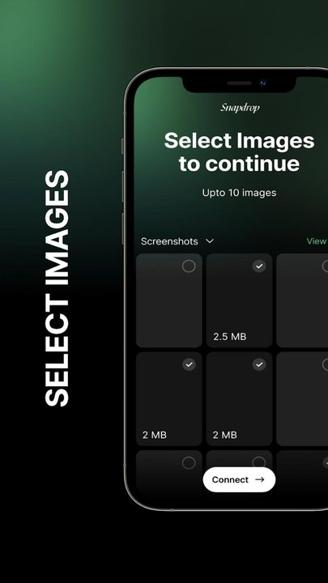
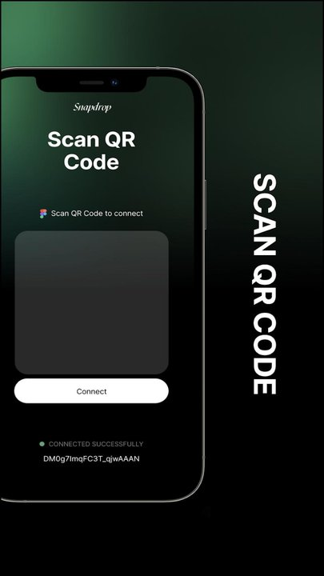
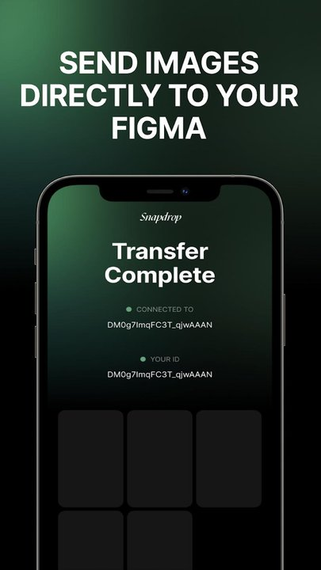

# Snapdrop: Phone to Figma

Send photos from your phone straight into Figma. Open the Snapdrop plugin in Figma, scan the QR code it shows, pick up to ten photos, and they land on your canvas. No cables, no account.

**[Get it on Google Play](https://play.google.com/store/apps/details?id=in.getsnapdrop.app)** · 1K+ installs · Android · 7 languages

<p>
  
  
  
</p>
<sub>Images from the Google Play listing.</sub>

## How it works

1. The Snapdrop plugin, running in Figma on your computer, shows a QR code for a room.
2. The app scans it and joins that room on a small Socket.IO relay ([`index.js`](index.js)).
3. You pick photos with Android's photo picker, or share them to Snapdrop from any app. The relay forwards them to the plugin, which places them on the canvas. The relay doesn't write them anywhere.

Once paired, you can keep sending without scanning again.

## What's in this repository

| Path | What it is |
|---|---|
| [`lib/`](lib) | The Flutter app: onboarding, home, QR and send screens, socket and media services |
| [`lib/l10n/`](lib/l10n) | Translations: English, Hindi, Spanish, Portuguese, French, Chinese and Arabic |
| [`index.js`](index.js) | The Node.js Socket.IO relay that pairs the app with the Figma plugin |
| [`ARCHITECTURE.md`](ARCHITECTURE.md) | How the app is put together, and what's planned next |

The Figma plugin is not in this repository.

## Built with

Flutter and Dart · `socket_io_client` · `qr_code_scanner_plus` · Android Photo Picker via `image_picker` · `receive_sharing_intent` · Firebase Crashlytics, Analytics, Remote Config and Performance · `flutter_localizations`

## Run it

App (Flutter 3.35):

```bash
flutter pub get
flutter run
```

Relay (Node.js):

```bash
npm install
npm start   # listens on port 3001
```

Release builds need the signing key, which is not in this repository; CI builds a debug APK.

## Privacy

[Privacy policy](https://saurabh-7973.github.io/snapdrop-privacy/)

## Licence

Source available for reading and learning, not for republishing as an app. See [LICENSE](LICENSE).

Built and maintained by [Saurabh Upadhyay](https://saurabhupadhyay.in).
